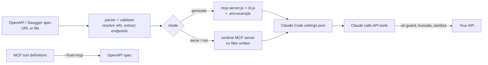

<div align="center">

# ay-api-gen

**Turn any OpenAPI spec into MCP tools and a CLI for Claude Code.**

[](LICENSE)
[](https://github.com/walidboulanouar/ay-api-gen/stargazers)
[](package.json)
[](https://modelcontextprotocol.io)


</div>

<!-- TODO: record docs/assets/hero.gif (terminal: run the quickstart below, then call a tool in Claude Code) -->

## Quickstart

```bash
# 1. Install
git clone https://github.com/walidboulanouar/ay-api-gen.git && cd ay-api-gen && npm install

# 2. Point it at any OpenAPI/Swagger spec (URL or local file) and generate an MCP server + CLI
node bin/ay-api-gen.js https://petstore.swagger.io/v2/swagger.json

# 3. Or skip codegen and serve the spec as an MCP server straight away (add this command to Claude Code's settings.json)
node bin/ay-api-gen.js serve https://petstore.swagger.io/v2/swagger.json
```

Generated files land in `.ay/apis/<name>/` and the server is registered in Claude Code's `settings.json` as `ay-api-gen:<name>` (skip with `--no-settings`). Restart Claude Code to see the tools. Requires Node 20 or newer.

## Features

- **OpenAPI to MCP server.** One tool per endpoint, generated as a standalone `mcp-server.js` (`src/mcp-generator.js`).
- **Matching CLI.** One command per endpoint, for example `users get --id 123` (`src/cli-generator.js`).
- **Runtime mode.** `serve` runs an MCP server from a spec with no generated files, over stdio or `--transport http` (`src/runtime/`).
- **Auth detection.** Reads Bearer, Basic, API key (header or query) and OAuth2 schemes from the spec and writes a matching `.env.example` (`src/auth-codegen.js`, `src/env-generator.js`).
- **Spec formats.** Swagger 2.0, OpenAPI 3.0 and 3.1, in JSON or YAML (`src/parser.js`, `src/yaml-parser.js`).
- **Reverse generation.** `--from-mcp` reads MCP tool definitions and writes an OpenAPI spec (`src/reverse.js`).
- **Tool pruning.** `--slim`, `--token-budget` and `--max-tools` trim large specs to fit a context budget (`src/slim.js`).
- **Spec discovery.** `discover <domain>` probes common paths for an OpenAPI spec (`src/discover.js`).
- **Spec diff.** `diff <old> <new>` shows which tools changed, were added or were removed (`src/diff.js`).
- **Free security lint.** `audit --baseline <spec>` flags unauthenticated mutating endpoints, sensitive params and weak auth (`src/spec-linter.js`).
- **Safety defaults.** Same-host base URL guard, private-IP deny-list, truncated and boundary-marked responses, capped tool descriptions, 25MB spec limit (`src/url-guard.js`, `src/truncate.js`, `src/desc-sanitize.js`).
- **Registry.** `list`, `doctor`, `remove` and `regen --all` manage generated APIs (`src/registry.js`, `src/doctor.js`).
- **Optional runtime tuning.** `AY_CACHE_TTL_MS` response cache and `AY_RATE_LIMIT_RPS` throttle (`src/response-cache.js`, `src/rate-limiter.js`).

The test suite (`npm test`) runs 166 checks with no network or API keys.

## How it works



Built by [AY Automate](https://ayautomate.com), an AI-native engineering company.

---

# ay-api-gen

Turn any OpenAPI spec into MCP tools for Claude Code — instantly.

```bash
npx ay-api-gen https://petstore.swagger.io/v2/swagger.json
```

That's it. Your API is now available as MCP tools in Claude Code. Restart Claude Code and start using them.

## What it does

Takes any OpenAPI/Swagger spec (URL or local file) and generates:

1. **MCP server** — one tool per endpoint, auto-registered in Claude Code
2. **CLI tool** — one command per endpoint, callable from bash
3. **.env.example** — auth config with the right env vars for that API

Also supports the reverse: read MCP tool definitions and generate an OpenAPI spec from them.

## Quick Start

### Runtime mode (zero files, instant)

Start an MCP server directly from any spec — no code generation:

```bash
# Start MCP server (add to Claude Code settings.json)
ay-api-gen serve https://petstore.swagger.io/v2/swagger.json

# Call an API endpoint directly
ay-api-gen run https://petstore.swagger.io/v2/swagger.json inventory list
ay-api-gen run https://petstore.swagger.io/v2/swagger.json pet get --petId 1
```

Add to `.claude/settings.json` for persistent use:

```json
{
  "mcpServers": {
    "petstore": {
      "command": "npx",
      "args": ["ay-api-gen", "serve", "https://petstore.swagger.io/v2/swagger.json"],
      "env": { "API_KEY": "your-key" }
    }
  }
}
```

### Generate mode (static files, customizable)

```bash
# Generate MCP server + CLI + .env.example
ay-api-gen https://api.example.com/openapi.json

# Generate with custom name and output dir
ay-api-gen ./my-api.json --name my-api --output ./generated
```

Output:

```
.ay/apis/my-api/
├── mcp-server.js      # Standalone MCP server
├── cli.js             # CLI tool
├── .env.example       # Auth env vars
├── endpoints.json     # Parsed endpoint data
├── config.json        # For regeneration
└── package.json       # Dependencies (auto-installed)
```

## How it maps

Every OpenAPI endpoint becomes an MCP tool:

```
HTTP Endpoint              MCP Tool           CLI Command
─────────────              ─────────          ───────────
GET    /users              list_users         users list
POST   /users              create_users       users create
GET    /users/{id}         get_user           users get --id 123
PUT    /users/{id}         update_user        users update --id 123
DELETE /users/{id}         delete_user        users delete --id 123
```

Nested resources work too:

```
GET /users/{id}/posts              → list_user_posts
GET /users/{id}/posts/{id}/comments → list_user_post_comments
```

## Auth detection

ay-api-gen reads security schemes from the spec and generates the right auth code:

| Auth Type | Detected From | Env Var |
|-----------|--------------|---------|
| Bearer token | `type: http, scheme: bearer` | `API_BEARER_TOKEN` |
| Basic auth | `type: http, scheme: basic` | `API_USERNAME` + `API_PASSWORD` |
| API Key (header) | `type: apiKey, in: header` | `API_KEY` |
| API Key (query) | `type: apiKey, in: query` | `API_KEY` |
| OAuth2 | `type: oauth2` (all flows) | `OAUTH_ACCESS_TOKEN` or `OAUTH_CLIENT_ID` + `OAUTH_CLIENT_SECRET` |

The generated `.env.example` tells you exactly what to set:

```bash
# Swagger Petstore — Environment Configuration
# API Key — sent as header: api_key
API_KEY=your-api-key-here

# OAuth2 Authentication (flows: implicit)
OAUTH_ACCESS_TOKEN=your-access-token-here
# Available scopes:
#   read:pets — read your pets
#   write:pets — modify pets in your account
```

## All commands

```bash
# Generate
ay-api-gen <spec-url-or-file> [options]     # OpenAPI → MCP + CLI
ay-api-gen --from-mcp <file> [options]      # Reverse: MCP → OpenAPI

# Runtime (no codegen)
ay-api-gen serve <spec>                     # Start MCP server directly
ay-api-gen run <spec> <resource> <action>   # Call API directly

# Manage
ay-api-gen list                             # List all generated APIs
ay-api-gen remove <name>                    # Remove from registry
ay-api-gen regen [name|--all]               # Regenerate from saved config
```

### Options

```
--output, -o <dir>   Output directory (default: .ay/apis/<name>/)
--name, -n <name>    API name override
--no-settings        Skip auto-registering in Claude Code settings.json
--from-mcp <file>    Read MCP tools from settings.json or server file
--all                Regenerate all APIs (with regen)
--help, -h           Show help
```

## Security

A spec you didn't write is untrusted input — its title, descriptions, and declared
base URL all end up in generated code or in Claude's context. `ay-api-gen` ships
several default-on mitigations (see `docs/security/THREAT-MODEL.md` for the full
picture):

- **Same-host base URL guard.** `API_BASE_URL` may only change the path of the
  spec's declared base URL, not the host/scheme — this stops a `settings.json`
  edit from silently rebinding your auth-attached requests to an attacker host.
  Opt into a genuine cross-host swap with `API_BASE_URL_ALLOW_HOST_OVERRIDE=1`
  (env) or `--allow-host-override` (generation time); both log loudly.
- **Private-IP / metadata deny-list.** Requests to loopback, link-local, RFC1918,
  and cloud-metadata ranges (e.g. `169.254.169.254`) are refused by default,
  both for the spec's declared base URL and at request time (catches DNS
  rebinding). Opt out with `AY_ALLOW_PRIVATE_HOSTS=1` for legitimate intranet APIs.
- **Truncated, boundary-marked responses.** API responses are capped (default
  8000 chars / 5 array items — tune with `AY_TRUNCATE_MAX_CHARS` /
  `AY_TRUNCATE_MAX_ITEMS`) and wrapped in `--- begin/end API response
  (untrusted) ---` markers before reaching Claude's context.
- **Untrusted, capped tool descriptions.** Tool and parameter descriptions are
  capped at 500 chars, forced single-line, and prefixed `[tool description,
  untrusted]` so the model has an anchor to discount injected instructions.
- **Namespaced settings entries.** Generated MCP servers register under
  `ay-api-gen:<name>` in `settings.json`, never overwriting an existing
  unprefixed entry from another tool without `--force`.
- **Spec linter (`--mode=b`).** Warns by default on unauthenticated mutating
  endpoints, sensitive identifiers in path or query params, privilege/value-sensitive
  request-body fields (`role`, `is_admin`, `balance`, etc. — unless marked
  `readOnly: true`), weak or missing globally-declared auth schemes, and specs
  that never declare a rate limit anywhere (429 response or `RateLimit-*`
  header); pass `--mode=b` to block generation on HIGH/CRITICAL
  findings, with `--accept-risks=<id>:<slug>,...` to explicitly override. Run it
  standalone, free, no license needed: `ay-api-gen audit --baseline <spec>`.
- **Path-safety guard on `--output`.** A small deny-list of catastrophic targets
  (system directories, the bare home directory root) is refused outright;
  anything else outside the current working directory is allowed (that's a
  normal use of `--output`) but prints a visible warning.
- **Locked, concurrency-safe writes.** `settings.json` and the API registry are
  protected by an advisory file lock — two `ay-api-gen` invocations racing to
  write the same file (e.g. a CI regen overlapping a local run) can't silently
  clobber each other's update.
- **Spec size cap.** A spec (fetched or local) over 25MB is rejected before
  it's ever fully read into memory or handed to the parser — a local file is
  rejected via a cheap `stat` check, a fetched URL via a streaming byte
  counter that can't be bypassed by a missing or lying `Content-Length`.

None of this defends against a fully malicious, deliberately-targeted spec with
unlimited creativity — see the threat model for what's still open.

## Runtime tuning (`serve` / generated servers)

Both opt-in — off by default, since the right values are per-API and an
unrequested default would be a surprising behavior change:

- **Response caching.** `AY_CACHE_TTL_MS=<ms>` caches idempotent `GET`/`HEAD`
  responses in memory for the given duration, keyed by method + full URL.
  Mutating methods are never cached.
- **Rate limiting.** `AY_RATE_LIMIT_RPS=<n>` throttles (delays, doesn't reject)
  outgoing requests to no more than `n` per second per host — protects both the
  upstream API and your own API key from being hammered by a fast-looping agent.
- **HTTP transport.** `ay-api-gen serve <spec>` defaults to stdio (the shape
  Claude Code expects when it spawns an MCP server). Pass
  `--transport http [--port 3000] [--host 127.0.0.1]` for an HTTP-reachable
  server instead — for a browser-based MCP client, or a server shared by a
  team. Binds to `127.0.0.1` by default; binding beyond localhost prints a
  loud warning, since this server has no built-in authentication of its own.

## Supported specs

- Swagger 2.0
- OpenAPI 3.0.x
- OpenAPI 3.1.x — including the JSON Schema 2020-12 `nullable` migration (both
  3.1's `type: ["string", "null"]` and legacy `nullable: true` are recognized —
  real-world specs mix both conventions even under a 3.1 header), whole-PathItem
  `$ref`s via `components.pathItems`, and `webhooks` (parsed structurally but
  never generated as callable tools — a webhook describes a request the API
  sends *to* you, not one this tool can call *on* the API; `ay-api-gen`
  generates outbound-calling tools, so there's nothing sensible to generate
  from them, but you'll get a clear message rather than silent data loss)
- JSON or YAML, both formats, no separate conversion step needed

Not implemented, because nothing in this codebase currently reads them (no
existing behavior to fix): `exclusiveMinimum`/`exclusiveMaximum`'s
boolean-vs-numeric form change, `examples` (plural) vs `example`, and `$ref`
sibling-keyword semantics — the last of these is genuinely contested within
the JSON Schema/OpenAPI community, not just unimplemented here.

## Multi-API setup

Register multiple APIs — each gets its own MCP server:

```json
{
  "mcpServers": {
    "stripe": {
      "command": "npx",
      "args": ["ay-api-gen", "serve", "https://raw.githubusercontent.com/stripe/openapi/master/openapi/spec3.json"],
      "env": { "API_KEY": "sk_test_..." }
    },
    "github": {
      "command": "npx",
      "args": ["ay-api-gen", "serve", "./specs/github.json"],
      "env": { "API_KEY": "ghp_..." }
    }
  }
}
```

## Deploy

### Docker

```bash
docker build -t ay-api-gen .
docker run -i -e API_KEY=sk-... ay-api-gen https://api.example.com/openapi.json
```

### GitHub Actions (auto-regen)

Included workflow at `.github/workflows/regen-apis.yml` runs weekly to regenerate all APIs from their saved specs and auto-commits changes.

### Fly.io

```bash
fly launch --name ay-api-gen
fly secrets set API_KEY=your-key
fly deploy
```

See [docs/DEPLOYMENT.md](docs/DEPLOYMENT.md) for all 8 deployment patterns.

## Programmatic API

```js
import {
  loadSpec,
  extractEndpoints,
  generateMCPServer,
  generateCLI,
  generateOpenAPIFromTools,
} from "ay-api-gen";

const spec = await loadSpec("https://api.example.com/openapi.json");
const parsed = extractEndpoints(spec);

// Generate MCP server source code
const mcpSource = generateMCPServer(parsed, { name: "my-api" });

// Generate CLI source code
const cliSource = generateCLI(parsed, { name: "my-api" });

// Filter endpoints before generating
parsed.endpoints = parsed.endpoints.filter(e => e.method === "GET");
const readOnlyMcp = generateMCPServer(parsed, { name: "read-only" });

// Reverse: MCP tools → OpenAPI
import { readMCPTools, generateOpenAPIFromTools } from "ay-api-gen";
const { tools } = readMCPTools("mcp-server.js");
const openApiSpec = generateOpenAPIFromTools(tools);
```

## Architecture

```
src/
├── parser.js            # OpenAPI 2.0/3.x parser, $ref resolution
├── validator.js         # Spec validation
├── auth-codegen.js      # Auth code generation (OAuth2, Bearer, Basic, API Key)
├── mcp-generator.js     # Static MCP server code generator
├── cli-generator.js     # Static CLI code generator
├── env-generator.js     # .env.example generator
├── settings-injector.js # Claude Code settings.json manager
├── registry.js          # API registry (list/remove/regen)
├── reverse.js           # MCP tools → OpenAPI spec
├── runtime/
│   ├── mcp-server.js    # Runtime MCP server (no codegen)
│   └── cli.js           # Runtime CLI (no codegen)
└── index.js             # Public API exports
```

See [docs/ARCHITECTURE.md](docs/ARCHITECTURE.md), [docs/PRIMITIVES.md](docs/PRIMITIVES.md), and [docs/PATTERNS.md](docs/PATTERNS.md) for full documentation.

## License

MIT
